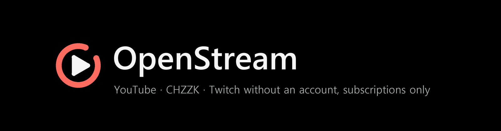
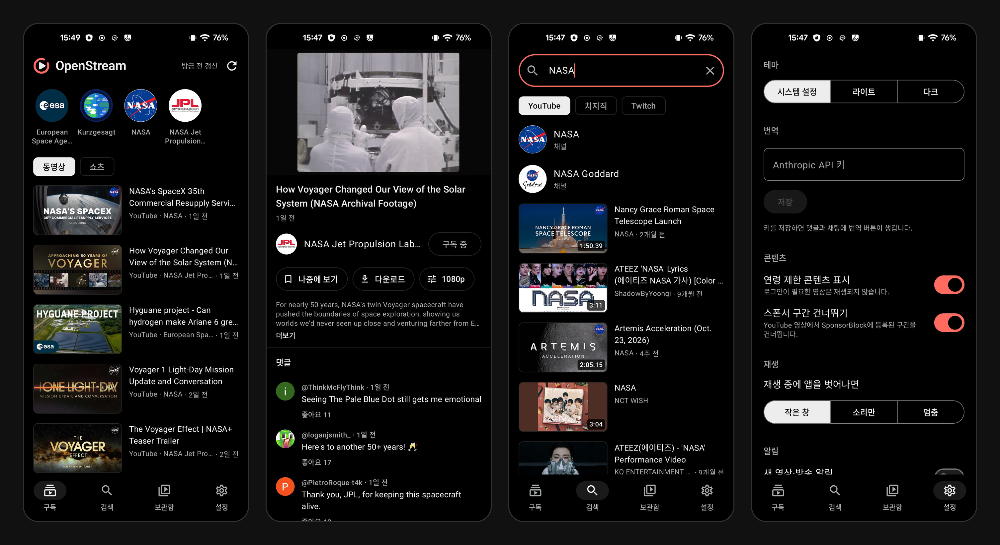

<div align="center">



<br>

**An Android app for watching YouTube, CHZZK and Twitch without signing in**<br>
The home screen shows only what your subscribed channels uploaded. Comments and live chat can be translated with Claude.

[](https://github.com/HPotty36/openstream/releases/latest)
[](#install)
[](#features)
[](#turning-translation-on)
[](#building)
[](LICENSE)

[**Get the APK**](https://github.com/HPotty36/openstream/releases/latest) · [Install](#install) · [Features](#features) · [Translation](#turning-translation-on) · [Building](#building) · [한국어](README.md)

</div>

<br>



The interface is in Korean; translation targets Korean.

## Install

1. Download `openstream-x.y.z.apk` from the [latest release](https://github.com/HPotty36/openstream/releases/latest) and open it.
2. Allow "install unknown apps" for your browser or file manager when Android asks.

Requires Android 8.0 or later. Later versions install from **Settings → Update**: the app checks for a new release once a day and compares the downloaded file's size and SHA-256 with the release before installing.

## Features

### A home screen of subscriptions only
Uploads from the channels you subscribed to, newest first. No recommendations, no trending, no live streams from channels you do not follow. Channels that are live move to the front of the row at the top and open straight into the broadcast (hold one for its channel); **전체** next to it lists every subscription by platform, with a name filter. Shorts appear only for subscribed channels and are left out of search.

### Three platforms
| | Search | Videos | Live | Chat and comments | Download |
|---|---|---|---|---|---|
| **YouTube** | ✓ | ✓ | ✓ | comments, live chat | up to 1080p |
| **CHZZK** | ✓ | replays | ✓ | live chat | replays |
| **Twitch** | ✓ | past broadcasts | ✓ | live chat | — |

All three are read without an account. Videos that need a login (age verification, memberships) do not play. Twitch past broadcasts are blocked in South Korea.

### Translation
With an Anthropic API key, video titles and channel names that are neither Korean nor English show up in Korean from the start, with a button to see the original. Comments, video descriptions and channel descriptions get a translate button, and live chat is translated as it arrives while translation is on. Korean text is left alone. Translated titles are kept on the device and not sent again.

### Playback
- **Quality**: live streams and replays start at the highest quality the broadcast offers (usually 1080p60); a menu picks a lower one or automatic
- **Picture-in-picture** when you leave the app while a video plays
- **Sound only** with the screen off or another app in front
- **SponsorBlock** skips sponsor segments on YouTube
- **Resume** from where you stopped
- **Timestamps**: a time like "12:34" in the description or a comment jumps there
- **Chapters**: YouTube chapters are marked on the seek bar, the current one is named under the video, and tapping it opens a list to jump from
- **Links** in descriptions, comments and channel descriptions open YouTube, CHZZK and Twitch videos and channels inside the app; a time link to the video you're watching seeks there, anything else opens in the browser
- **GIFs** in YouTube comments and Twitch chat show and move
- **Keyboard**: Space/K play-pause, J/L/←/→ seek 10 s, F full screen

### Downloads
Videos are saved to `Download/OpenStream` and play from the library. YouTube's separate video and audio streams are joined into one MP4 without re-encoding.

### Importing subscriptions
Pick the zip from [Google Takeout](https://takeout.google.com) (YouTube subscriptions only) as it is. NewPipe's json and zip exports and this app's own backup are read too.

### Also
- **Tablets and external monitors**: side navigation, grids, and comments beside the video
- **Notifications** for new uploads and streams going live, checked every 30 minutes; off by default
- **Sharing** from the video screen, the channel screen, or a long press in any list sends the platform's own address (youtu.be, chzzk.naver.com, twitch.tv); videos and replays can be shared from the moment you're at
- **Themes**: system, light, dark (pure black)
- **Backup** of subscriptions, watch later and history to one file

## Turning translation on

1. Create an API key in the [Anthropic Console](https://console.anthropic.com).
2. Save it under **Settings → 번역**.

The key is encrypted with the Android Keystore and stays on the device; it is not written to backups. Only text being translated is sent to Anthropic: titles and channel names that are neither Korean nor English when they appear on screen, and comments, descriptions and chat when you translate them or turn chat translation on. Usage is billed to your Anthropic account.

## Building

Needs Android Studio (JDK 17 or later) and the Android SDK.

```bash
git clone https://github.com/HPotty36/openstream.git
cd openstream
./gradlew testDebugUnitTest assembleDebug
```

The APK lands in `app/build/outputs/apk/debug/`. Debug builds use a different app id (`dev.openstream.debug`), install next to the release build and do not receive updates. Checks that talk to the real services run only with `-Plive=true`.

## Notice

A personal hobby project, not affiliated with YouTube, NAVER (CHZZK) or Twitch. It reads public web responses, not official APIs, and can stop working without notice when a service changes. Videos and channel images in the screenshots belong to their owners.

YouTube is read with [NewPipeExtractor](https://github.com/TeamNewPipe/NewPipeExtractor) (GPL-3.0); sponsor segments come from [SponsorBlock](https://sponsor.ajay.app). This repository is licensed under [GPL-3.0](LICENSE).
