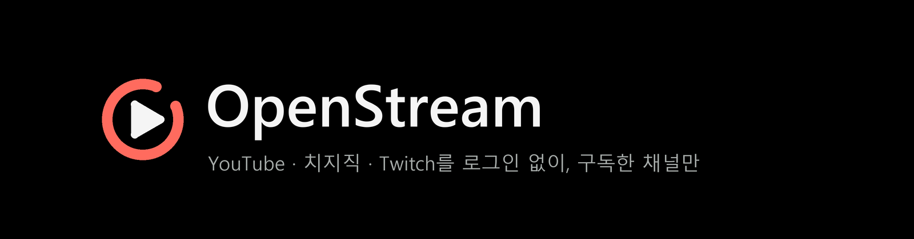
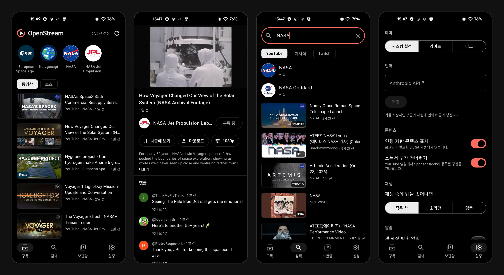

<div align="center">



<br>

**YouTube·치지직·Twitch를 로그인 없이 한 앱에서 보는 안드로이드 앱**<br>
홈에는 구독한 채널의 새 영상만 나오고, 댓글과 라이브 채팅은 Claude로 번역합니다.

[](https://github.com/HPotty36/openstream/releases/latest)
[](#설치)
[](#기능)
[](#번역-켜기)
[](#직접-빌드하기)
[](LICENSE)

[**APK 받기**](https://github.com/HPotty36/openstream/releases/latest) · [설치](#설치) · [기능](#기능) · [번역 켜기](#번역-켜기) · [직접 빌드하기](#직접-빌드하기) · [English](README.en.md)

</div>

<br>



## 설치

1. [릴리스](https://github.com/HPotty36/openstream/releases/latest)에서 `openstream-x.y.z.apk`를 받아 엽니다.
2. 브라우저나 파일 앱에 "알 수 없는 앱 설치"를 허용하라는 안내가 나오면 허용합니다.

Android 8.0 이상에서 동작합니다. 다음 버전부터는 **설정 → 업데이트**에서 확인하고 설치합니다. 앱이 하루에 한 번 새 릴리스가 있는지 확인하고, 설치 전에 받은 파일의 크기와 SHA-256을 릴리스와 맞춰 봅니다.

## 기능

### 구독 홈
홈에는 구독한 채널이 올린 영상만 최신순으로 나옵니다. 추천, 인기 급상승, 모르는 채널의 라이브는 없습니다. 맨 위 채널 줄에서 방송 중인 채널이 앞으로 오고 누르면 바로 방송이 열립니다(길게 누르면 채널 화면). 줄 옆의 **전체**를 누르면 구독 채널을 플랫폼별로 나눠 보고 이름으로 찾을 수 있습니다. 쇼츠는 구독한 채널 것만 따로 모아 보고, 검색 결과에서는 뺍니다.

### 세 플랫폼
| | 검색 | 영상 | 라이브 | 채팅·댓글 | 다운로드 |
|---|---|---|---|---|---|
| **YouTube** | ✓ | ✓ | ✓ | 댓글, 라이브 채팅 | 1080p까지 |
| **치지직** | ✓ | 다시보기 | ✓ | 라이브 채팅 | 다시보기 |
| **Twitch** | ✓ | 지난 방송 | ✓ | 라이브 채팅 | — |

세 곳 모두 계정 없이 읽기만 합니다. 로그인해야 볼 수 있는 영상(성인 인증, 멤버십)은 재생되지 않습니다. Twitch 지난 방송은 한국에서 막혀 있습니다.

### 번역
Anthropic API 키를 넣으면 한국어도 영어도 아닌 영상 제목과 채널 이름이 처음부터 한국어로 나옵니다. **원문 보기**를 누르면 원래 제목으로 돌아갑니다. 댓글, 영상 설명, 채널 소개에는 **번역** 버튼이 생기고, 라이브 채팅은 번역을 켜 두면 새 채팅이 올라오는 대로 한국어로 바뀝니다. 한국어 글은 건드리지 않습니다. 한 번 번역한 제목은 기기에 저장해 두고 다시 보내지 않습니다.

### 재생
- **화질** — 라이브와 다시보기는 방송이 내보내는 가장 높은 화질(보통 1080p60)로 시작하고, 메뉴에서 낮은 화질이나 자동을 고를 수 있습니다.
- **작은 창(PiP)** — 재생 중에 홈으로 나가면 영상이 작은 창으로 줄어듭니다.
- **소리만** — 화면을 끄거나 다른 앱으로 가도 소리가 이어집니다.
- **SponsorBlock** — YouTube 영상의 스폰서 구간을 건너뜁니다.
- **이어 보기** — 보던 영상은 멈춘 곳에서 다시 시작합니다.
- **타임스탬프** — 영상 설명과 댓글의 "12:34" 같은 시간을 누르면 그 장면으로 넘어갑니다.
- **챕터** — YouTube 영상에 챕터가 있으면 재생바에 구간이 표시되고, 지금 보는 챕터 이름이 영상 아래에 뜹니다. 누르면 챕터 목록이 펼쳐지고 원하는 챕터로 바로 넘어갑니다.
- **링크** — 영상 설명, 댓글, 채널 소개의 링크를 누를 수 있습니다. YouTube·치지직·Twitch 영상과 채널 링크는 앱 안에서 열리고, 보고 있는 영상의 시간 링크는 그 시간으로 넘어가며, 나머지는 브라우저로 엽니다.
- **GIF 댓글** — YouTube 댓글에 붙은 GIF가 YouTube 앱에서처럼 움직이며 보입니다.
- **키보드** — Space·K 재생/멈춤, J·L·←·→ 10초 이동, F 전체 화면.

### 다운로드
영상을 받아 `Download/OpenStream` 폴더에 저장하고, 보관함에서 바로 재생합니다. 영상과 소리가 따로 오는 YouTube는 다시 인코딩하지 않고 MP4 하나로 합칩니다.

### 구독 가져오기
[Google 테이크아웃](https://takeout.google.com)에서 YouTube 구독정보만 골라 받은 zip 파일을 그대로 고르면 됩니다. NewPipe에서 내보낸 json·zip과 이 앱의 백업 파일도 읽습니다.

### 그 밖에
- **태블릿·외장 모니터** — 화면이 넓으면 탭이 옆으로 가고 목록이 격자로 바뀝니다. 영상 화면은 영상 옆에 댓글이 놓입니다.
- **알림** — 구독한 채널을 30분마다 확인해 새 영상과 방송 시작을 알립니다. 기본은 꺼져 있습니다.
- **테마** — 시스템 설정·라이트·다크. 다크는 완전한 검정입니다.
- **백업** — 구독, 나중에 보기, 시청 기록을 파일 하나로 내보내고 가져옵니다.

## 번역 켜기

1. [Anthropic Console](https://console.anthropic.com)에서 API 키를 만듭니다.
2. **설정 → 번역**에 키를 넣고 저장합니다.

키는 Android Keystore로 암호화해 기기에만 저장하고, 백업 파일에는 넣지 않습니다. Anthropic으로는 번역할 글만 보냅니다. 한국어·영어가 아닌 제목과 채널 이름은 화면에 나올 때, 댓글·설명·채팅은 번역을 누르거나 켤 때입니다. 요금은 Anthropic 계정에 사용량만큼 청구됩니다.

## 직접 빌드하기

Android Studio(JDK 17 이상)와 Android SDK가 필요합니다.

```bash
git clone https://github.com/HPotty36/openstream.git
cd openstream
./gradlew testDebugUnitTest assembleDebug
```

APK는 `app/build/outputs/apk/debug/`에 생깁니다. 디버그 빌드는 앱 ID가 달라서(`dev.openstream.debug`) 릴리스판 옆에 따로 설치되고, 업데이트를 받지 않습니다. 실제 서비스에 붙는 검사는 `-Plive=true`를 붙여야 돕니다.

<details>
<summary><b>프로젝트 구조</b></summary>

<br>

```
app/src/main/java/dev/openstream/
  platform/            세 플랫폼의 공통 인터페이스(Platform.kt)와 구현
    youtube/           NewPipeExtractor로 검색·재생·댓글, RSS로 새 영상, 라이브 채팅
    chzzk/             치지직 검색·라이브·다시보기·채팅
    twitch/            Twitch 검색·라이브·채팅
  feed/                구독 홈과 새 영상 모으기
  search/ channel/     검색, 채널 화면
  watch/               영상 화면, 댓글, 채팅, 작은 창·소리만 재생, 받은 파일 재생
  library/             구독·나중에 보기·기록 저장(SQLite), 가져오기와 백업
  download/            받기, 영상+소리 합치기, 저장된 파일 목록
  translate/           Anthropic API로 번역
  sponsor/ notify/     SponsorBlock, 새 영상 알림
  update/              GitHub 릴리스 확인과 설치
  settings/ ui/        설정, 테마와 공용 화면 조각
```

</details>

## 고지

개인 취미 프로젝트입니다. YouTube, 네이버(치지직), Twitch와 관련이 없고, 각 서비스의 공식 API가 아닌 공개된 웹 응답을 읽습니다. 서비스가 바뀌면 예고 없이 동작하지 않을 수 있습니다. 화면 예시의 영상과 채널 이미지는 각 권리자의 것입니다.

YouTube 읽기에 [NewPipeExtractor](https://github.com/TeamNewPipe/NewPipeExtractor)(GPL-3.0)를 쓰고, 스폰서 구간은 [SponsorBlock](https://sponsor.ajay.app)에서 받습니다. 이 저장소는 [GPL-3.0](LICENSE)으로 배포합니다.
